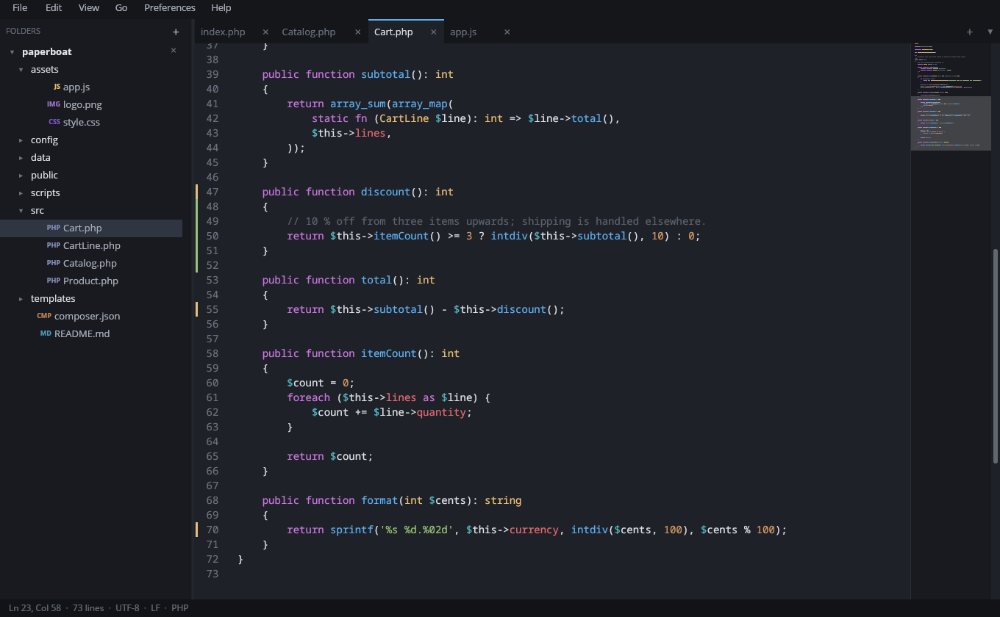
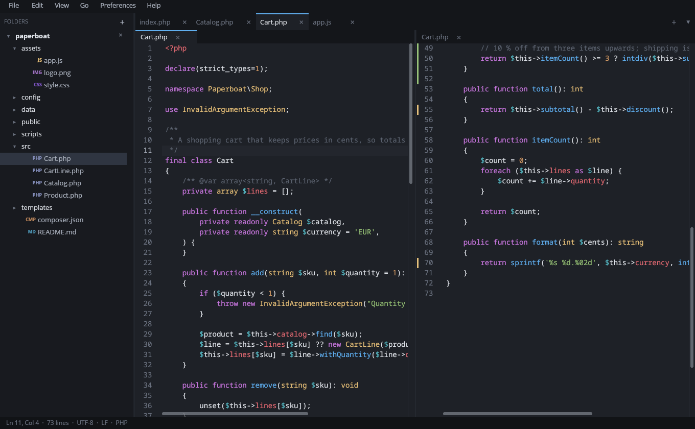
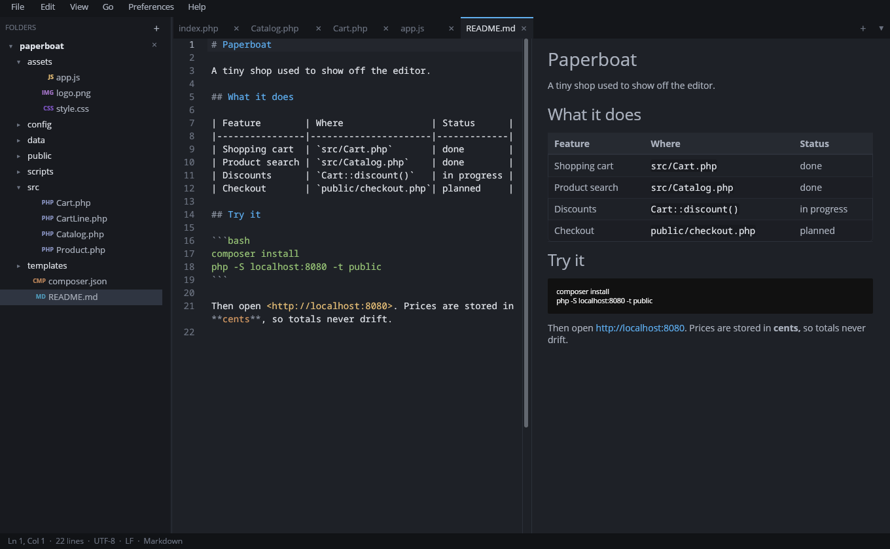
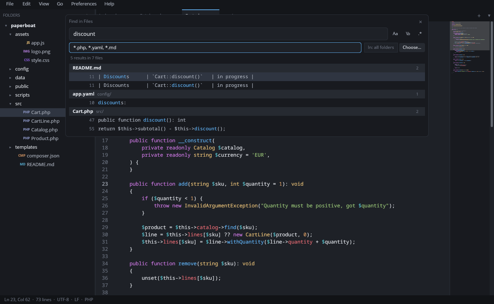
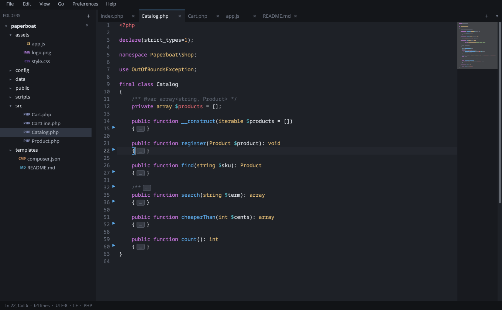

# VeloEdit

[](https://github.com/tkinali/veloedit/actions/workflows/ci.yml)
[](https://github.com/tkinali/veloedit/releases/latest)
[](LICENSE)

A fast, light, GPU-accelerated text editor for Linux (and, as a preview, Windows), in the spirit of Sublime Text.
Written in Rust with [iced](https://iced.rs). Opens in well under 100 ms, keeps your
unsaved work across restarts, and never blocks the UI on disk, git or highlighting.

**[Website](https://tkinali.github.io/veloedit/)** · **[100-second tour](https://tkinali.github.io/veloedit/#tour)** · **[Download](https://github.com/tkinali/veloedit/releases/latest)** · [Changelog](CHANGELOG.md)



## Features

- **Tabs that fit the file**: text editor, hex editor (binary files, in-place byte patching),
  image preview. Huge files open instantly (lazy loading); files over the text limit open as hex.
- **Editing**: multi-cursor (`Ctrl+Click`, `Ctrl+D`, `Ctrl+Alt+↑/↓`), find/replace with regex,
  soft wrap, bracket matching, undo/redo that never loses a step, minimap, line numbers,
  git gutter (added / modified / removed lines).
- **Code folding for every language** (indentation based, like Sublime): gutter arrows,
  `Ctrl+Shift+[` / `]`, *Fold All*, *Fold Level N* in the command palette.
- **Syntax highlighting** for ~50 languages: 25 tree-sitter grammars (PHP with its HTML/CSS/JS,
  JavaScript/TypeScript, Python, Rust, Go, Java, Ruby, Lua, Markdown, YAML, TOML, …) plus a
  light lexer for the rest (Kotlin, Swift, C++, C#, SQL, Dart, Twig/Jinja, …).
- **Syntax on demand**: *View → Syntax…* (or click the language in the status bar) lists every language and applies the one you pick; *Auto Detect* gives the decision back. A text in a new tab that starts like a web page (`<!DOCTYPE html>`, `<html>`, `<?xml`, `#!/bin/bash`, …) is colored as soon as you paste it.
- **Format menu entries** in *View*: *Convert Indentation to Spaces / Tabs* (uses the tab size of the settings) and *Line Endings: Unix (LF) / Windows (CRLF)*. Each is one undo step.
- **Project tools**: multi-root folder sidebar (resizable, file-type badges, right-click menu with
  new/rename/trash/copy path), `Ctrl+P` fuzzy file open, `Ctrl+Shift+P` command palette,
  `Ctrl+Shift+F` find in files with a `*.php, !vendor` filter and folder scope.
- **Git colors in the sidebar**: in a git folder, files changed since the last commit are colored
  like in VS Code: yellow `M` (edited), green `U` (new) / `A` (staged), red `!` (conflict); a folder
  shows a dot and the color of the strongest change inside it. A folder that holds several sites
  (such as `/var/www`) works too: every direct subfolder with a `.git` is its own repository, and
  its row shows the strongest change in it. It follows saves, a `git commit` or `git checkout`
  made in a terminal, and *Git: Refresh Gutter* in the palette forces it.
- **Markdown preview** next to the source, with real wrapping tables.
- **Split view**: right-click a tab → *Split Right* / *Split Down* shows the same file twice, each pane with its own name bar, scroll position and caret, edits and undo shared. Tabs can be dragged to reorder them.
- **Hot exit**: tabs, folders and *unsaved drafts* come back exactly as you left them.
  Unsaved tabs are named after their first line, so scratch notes are easy to tell apart.
- **Preview tabs**: a single click on a file in the sidebar opens it in an italic preview tab that the next click replaces; double-click it (or start typing) to keep it.
- **One window**: opening a file from the file manager hands it to the running VeloEdit.
- **Trim trailing whitespace on save** (off by default; *Preferences → Settings → Trim on save*): saving removes the spaces and tabs at line ends (Markdown's two-space line breaks stay). It is one undo step, so `Ctrl+Z` brings them back.
- **Safe on network mounts** (SFTP/sshfs/NFS, VPN): a frozen mount never freezes the window, a reload from disk is an undo step and never empties a buffer that has text, and a window stuck on a dead mount does not block the next launch.
- Menu bar, light and dark themes, settings panel, drag and drop, external-change detection. The window title shows the file's full path.

| | |
|---|---|
|  |  |
|  |  |

## Install

### Prebuilt (Linux x86_64 / aarch64)

Download the file for your system from the [Releases page](https://github.com/tkinali/veloedit/releases/latest):

| File | For | Install |
|---|---|---|
| `veloedit_<version>-1_amd64.deb` / `_arm64.deb` | Debian, Ubuntu, Mint | `sudo apt install ./veloedit_*.deb` |
| `veloedit-<version>-1.x86_64.rpm` / `.aarch64.rpm` | Fedora, openSUSE, RHEL | `sudo dnf install ./veloedit-*.rpm` |
| `VeloEdit-<version>-<arch>.AppImage` | any distribution | `chmod +x VeloEdit-*.AppImage && ./VeloEdit-*.AppImage` |
| `veloedit-<version>-<arch>-linux.tar.gz` | any distribution, no root | see below |

The packages install `/usr/bin/veloedit`, the icon and a launcher entry ("Open with VeloEdit" works in
the file manager); `sudo apt remove veloedit` / `sudo dnf remove veloedit` removes it. The AppImage needs
FUSE (Ubuntu 22.04 and later: `sudo apt install libfuse2`), or run it with `--appimage-extract-and-run`.

The tarball installs into your home folder:

```bash
tar xzf veloedit-*-linux.tar.gz
cd veloedit-*-linux
./install.sh                 # into ~/.local (no root); `PREFIX=/usr/local sudo -E ./install.sh` for everyone
```

`./install.sh --uninstall` removes it again. All files are built on Ubuntu 22.04 and need glibc 2.35 or newer
(Ubuntu 22.04+, Fedora 36+, Debian 12+).

You need a normal Linux desktop session: X11 or Wayland, a font, and either a Vulkan/OpenGL driver
(Mesa is fine) or nothing at all - without a usable GPU VeloEdit falls back to its software renderer
(`ICED_BACKEND=tiny-skia veloedit` forces it). File dialogs use `xdg-desktop-portal` (present on every
mainstream desktop).

### Windows 10 / 11 (preview)

Download `veloedit-<version>-x86_64-windows.zip` from the Releases page, unpack it anywhere and
double-click `veloedit.exe`. There is no installer: to remove VeloEdit delete the folder (settings
and the saved session live in `%APPDATA%\veloedit` and `%LOCALAPPDATA%\veloedit`).

The Windows build is new and much less tested than the Linux one. The program is not code-signed,
so SmartScreen may warn on the first start (*More info* -> *Run anyway*). The git change marks need
[Git for Windows](https://git-scm.com/download/win); everything else works without it.

### From source

Rust **1.92 or newer** (use [rustup](https://rustup.rs) if your distribution's is older) and a C compiler
(tree-sitter grammars are C):

```bash
# Debian/Ubuntu: sudo apt install build-essential        Fedora: sudo dnf install gcc
cargo install --path .              # -> ~/.cargo/bin/veloedit
# or:
cargo build --release && packaging/install.sh      # -> ~/.local/bin + launcher entry + icon
```

## Use

```bash
veloedit                      # restores your last session
veloedit file.php src/        # files open as tabs, folders join the sidebar (in the running window if any)
veloedit --new-window x.txt   # force a separate window
veloedit --help
```

| Keys | |
|---|---|
| `Ctrl+O` / `Ctrl+Shift+O` | open file / add folder |
| `Ctrl+P` / `Ctrl+Shift+P` | go to file / command palette |
| `Ctrl+F` `Ctrl+H` `F3` | find / replace / next |
| `Ctrl+Shift+F` | find in files |
| `Ctrl+G` | go to line (`:42`; in hex: `:0x1F40`) |
| `Ctrl+B` | toggle sidebar |
| `Ctrl+S` `Ctrl+W` `Ctrl+N` `Ctrl+Q` | save / close tab / new / quit |
| `Ctrl+Tab` `Ctrl+Shift+Tab` | next / previous tab |
| `Ctrl+Shift+[` `Ctrl+Shift+]` | fold / unfold (the bracket *keys*, e.g. ğ/ü on a Turkish keyboard) |
| `Ctrl+=` `Ctrl+-` `Ctrl+0` (numpad `+` `-` `0` too), `Ctrl+wheel` | zoom in / out / reset |
| `Ctrl+,` | settings |

Settings live in `~/.config/veloedit/settings.json` (also editable from the settings panel), the
session in `~/.local/state/veloedit/`. Both are plain JSON. Keys: `theme`, `font_size`, `tab_size`,
`word_wrap`, `minimap`, `menu_bar`, `markdown_preview`, `trim_trailing_whitespace`.

Markdown keeps its hard line breaks: in `.md` files, two or more spaces at the end of a line that is
followed by more text are left alone (everywhere else, and at the end of a paragraph, they are cut).

## Status

Version 0.1. Developed and tested on Fedora 44 (X11, Mesa/RADV). Wayland and other distributions
should work but have had less testing - reports are welcome. Known limits are listed in
[ARCHITECTURE.md](ARCHITECTURE.md) (§9); the architecture notes are in Turkish.

## Contributing

`cargo test --release` runs the whole suite headless (UI snapshots land in `target/ui-snapshots/`).
`scripts/package.sh` builds the release tarball. Grammars and the lexer table are in `src/syntax/`.
How a release is made: [RELEASING.md](RELEASING.md) (in Turkish).

## License

MIT - see [LICENSE](LICENSE). Third-party notices: [THIRD-PARTY-LICENSES.txt](THIRD-PARTY-LICENSES.txt)
(regenerate with `python3 scripts/third_party_licenses.py`).
